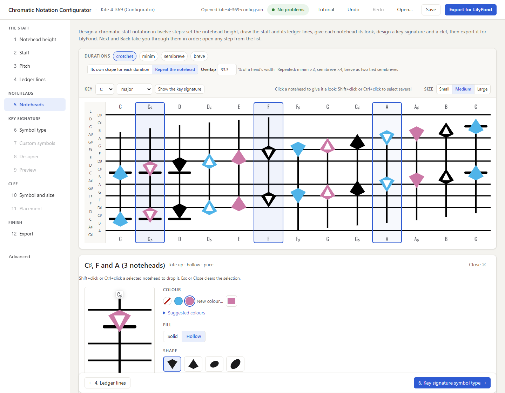

# Chromatic Notation Configurator

A browser-based tool for designing custom chromatic music notation systems. The Configurator lets you define staff lines, ledger lines, notehead shapes, colors, and rules — then preview your notation and export it as a LilyPond configuration file.

## What It Does

The Configurator is the design environment where notation creators make creative decisions:

- **Give each notehead its look** — click it on the staff (Shift+click or
  Ctrl+click to select several) and choose its colour, fill, shape and
  size; the looks are kept as cumulative rules
- **Import notehead shapes** from SVGs produced by the Music Glyph Toolkit
- **Configure staff geometry** — any number of lines at any semitone positions
- **Configure ledger lines** — automatic, or your own rules for which notes get them
- **Colour noteheads directly**, or start from suggested colour sets
  (colour-blind-safe ones among them); a colour-blind version of a
  notation is simply a second config saved under another name
- **Nudge a notehead** up or down by dragging it on the staff
- **Add a key signature** — the key's scale as noteheads, traditional
  sharps and flats, or your own symbols, designed on a magnified canvas
  and checked across all 105 keys
- **Add a clef** — the dozenal, treble, bass or alto clef, or one imported
  from SVG
- **Preview your notation** on a staff of octave chords, as the engine engraves it
- **Export `.ly` config files** that the ChromaticNotationBase engine consumes
- **Save/load configurations** as JSON for iterative design, in the
  folder you choose
- **Undo and redo** every change to the design



## Three-Tool Pipeline

The Configurator sits in the middle of a three-tool workflow:

```
Inkscape + Music Glyph Toolkit    (Shape authoring & normalization)
    ↓ produces clean SVG with data- attributes
Chromatic Notation Configurator   (Notation design & rule assignment)  ← YOU ARE HERE
    ↓ reads SVG metadata, user configures rules
.ly config file                   (Generated Scheme code)
    ↓
LilyPond + CNB engine             (Renders music)
    ↓
PDF / SVG / PNG output
```

**Related repositories:**
- [lilypond-chromatic-notation-base](https://github.com/darndestdabbler/lilypond-chromatic-notation-base) — LilyPond engine that renders music from exported config files
- [inkscape-music-glyph-toolkit](https://github.com/darndestdabbler/inkscape-music-glyph-toolkit) — Inkscape extension for authoring notehead shapes

## Getting Started

### Prerequisites

- A desktop web browser — see [Supported browsers](#supported-browsers)
- [Node.js](https://nodejs.org/) 18+ for the unit tests and serving the app locally; 20+ for the
  browser UAT (its `playwright-core` 1.64 needs it)

### Usage

Use the configurator online at
**<https://configurator.darndestdabbler.org/>**. Nothing to install. The
site is updated at each release.

To run it locally, for development: the application is `cnb/index.html`.
It uses ES modules, so serve the repository over HTTP rather than opening
the file directly:

```bash
# from the repository root — either of:
npx serve .
python -m http.server 8000
```

then open `http://localhost:8000/cnb/` (`npx serve` uses port 3000:
`http://localhost:3000/cnb/`). Keep the trailing slash: `npx serve`
rewrites `/cnb/index.html` to `/cnb`, where the page cannot find its
modules. No build step required. Opened from disk (`file://`), the browser blocks
the modules, and the page shows a notice saying so, with a link to the
live site and these commands.

The site is published by `.github/workflows/pages.yml` on each `v*` release
tag. It copies the app with `node cnb/site/assemble-site.mjs <outDir>`
(`index.html`, `src/`, `ui/`, `assets/`; no build).

### Supported browsers

The app is checked in these desktop browsers by the browser UAT
(`cnb/uat/uat-hostile-input.mjs` runs the same checklist in all three; the
other drivers run in Chromium). The Chromium is Playwright's own build
(Chrome for Testing, `chromium-1248`), not an installed Google Chrome:

| Browser | Version checked | Status |
|---|---|---|
| Chromium (Playwright's build) | 156 | Supported |
| Firefox | 157 | Supported |
| Microsoft Edge | 155 | Supported |

Safari and mobile browsers are untested; mobile layouts are not a goal.

## Running the tests and UAT

Two suites, the same two that [`dabbler.yaml`](dabbler.yaml) declares as the
run of record.

**Unit suite (`cnb-unit`)** — every `cnb/tests/*-tests.js` file plus the
gallery gate (`cnb/tests/check-gallery-examples.js`). It needs only Node.js
18+, takes no arguments, and runs whole in about a second:

```bash
node cnb/tests/run-tests.js     # or: npm test
```

**Browser UAT (`cnb-uat`)** — the Playwright drivers under `cnb/uat/` drive
the real app. The root `package.json` declares only dev tooling
(`playwright-core`); the app itself stays dependency-free. The prerequisites
are per machine and the suite does not install them. The drivers need Node.js 20+.
Once per clone:

```bash
npm install                                     # installs the locked playwright-core into node_modules/
npx playwright-core install chromium firefox    # its own installer: the Chromium and Firefox builds it was made for
```

Microsoft Edge is used from its normal installation (Playwright channel
`msedge`). Then:

```bash
npm run uat     # runs every cnb/uat/uat-*.mjs in turn; stops at the first failure
```

Most drivers run in Chromium; `uat-hostile-input.mjs` runs its checklist in
Chromium, Firefox and Edge. A driver whose prerequisites are missing exits 2
naming what is missing. A single driver runs on its own with
`node cnb/uat/uat-<name>.mjs`. `CNB_UAT_CHROMIUM` points the drivers at a
specific Chromium binary, and `CNB_UAT_PLAYWRIGHT` at another directory whose
`node_modules` holds `playwright-core`. Results are recorded in
[`docs/uat-status.md`](docs/uat-status.md).

## End-to-End Walkthrough: From Shape to Rendered Score

This is the full three-tool pipeline in practice — the same path used to
verify the ecosystem's shared release gate (a Configurator-designed system
rendered through the engine, pixel-identical to the engine repo's golden
baseline). This section covers the design half; the render half lives in
the [engine repository's README](https://github.com/darndestdabbler/lilypond-chromatic-notation-base)
— link, don't duplicate.

### 1. Install the Inkscape extension and author a shape

1. Install the [Music Glyph Toolkit](https://github.com/darndestdabbler/inkscape-music-glyph-toolkit):
   copy `music_glyph_toolkit.inx` and `music_glyph_toolkit.py` into your
   Inkscape user extensions folder (Windows:
   `%APPDATA%\inkscape\extensions\`; Mac/Linux:
   `~/.config/inkscape/extensions/`) and restart Inkscape. The tool
   appears under **Extensions → Music Typography → Music Glyph Toolkit…**
2. Draw your notehead (and an optional hollow cutout), convert everything
   to paths (`Ctrl+Shift+C`), and run the toolkit in Notehead mode. It
   normalizes the SVG onto the 100-units-per-semitone grid and bakes in
   the metadata the Configurator reads: `data-semitone-height`, stem
   placemarker rects (attachment anchors), and pre-baked
   `data-lilypond-notehead` / `data-lilypond-hollow` path strings.
   A stem is drawn where its rect is, centred on it, in the preview and the
   engraving. If minims attach their stems elsewhere, draw the optional
   second pair of rects, `stem-minim-up` / `stem-minim-down`; without it,
   minims use the crotchet anchors.

### 2. Import the shape into the Configurator

Open the app (see Usage above), click a notehead on the staff, and use
**Import from SVG…** in the notehead panel's Shape row (click it, or drop
the `.svg` on it). The importer extracts the SVG paths, the LilyPond
paths, and the stem anchors, including the minim pair when present
(stored in semitone units; the exporter converts them to staff-space
units at export time). Warnings are shown for shapes missing
`data-lilypond-*` attributes — those fall back to automatic path
conversion at export. After the import the panel shows the shape enlarged:
click it at the height that should sit on the pitch (its reference point,
such as its centre of mass), or press **Done** to keep its middle. The
noteheads move to it and the staff lines and ledger lines stay where they
are, in the preview and the export alike; **Pick the point that sits on the
pitch** in the Shape row changes it later, and **Centre** puts it back. A
file that is not toolkit output, or not an SVG at
all, is refused with a message saying so, and the configuration is left
unchanged; so is a JSON file that is not a configuration this version can
open.

A file drawn by hand in Inkscape imports where it was drawn: the importer
reads the transforms of every group and layer, every path command
(relative ones, arcs and curves included) and rects, circles, ellipses,
polygons and polylines, and stores the result in the file's own units
(those of its page). The notehead still needs `id="notehead"` (and its
hollow `id="hollow"`); a clef needs nothing, every drawn path is its
glyph. Fit the page to the drawing (Edit > Resize Page to Selection) so
that the clef the canvas draws is the clef the engine engraves. What the
importer cannot read is refused, naming the element and what to do in
Inkscape: text (Path > Object to Path), a path with no fill, drawn by its
stroke (Path > Stroke to Path), a clone (Edit > Clone > Unlink Clone), a
bitmap (Path > Trace Bitmap), a nested SVG (Object > Ungroup), and a clip,
mask or filter (Object > Clip > Release, Object > Mask > Release, Filters >
Remove Filters). The tutorial's C clef,
[`docs/playbook/tutorial/downloads/c-clef.svg`](docs/playbook/tutorial/downloads/c-clef.svg),
is such a file: a layer moved by a transform, relative commands and arcs.

### 3. Design the notation system

The page is the staff canvas, with one step at a time beside it. Above
the staff, the canvas toolbar chooses what it shows: the durations, and
beside them whether longer durations get **Its own shape for each
duration** or **Repeat the notehead** (as the engine engraves them: minim
×2, semibreve ×4, and a breve as two tied semibreves), with
**Hollow minims** beside the first, which adds one ordinary rule making
every minim hollow (unticked, it removes it; Advanced shows it with the
other rules);
and the
**Key**, a tonic and a mode (major,
minor and the church modes LilyPond's `\key` names), whose signature the
staff draws. While the signature is off, **Show the key signature** turns
it on, as the scale stack: the key's scale as stacked noteheads, as the
engine engraves it.

A notation is designed in twelve numbered steps, listed in the sidebar
under their groups (The staff, Noteheads, Key signature, Clef, Finish),
and the page opens on the first. **Next** and **Back**, at the bottom of
the window, take you through them in order, and any step can be opened
from the list at any time. A step with nothing to edit yet is greyed, and
says why: steps 8 and 9 until a key signature is shown, step 7 until it
uses symbols of its own (Custom marks in step 6), step 11 until a clef is. It starts from a conventional notehead on the 4-8 staff.

**The staff**

1. **Notehead height** — how tall every notehead is, in semitones; each
   keeps its shape's proportions. Set it first: the staff, the ledger lines
   and each notehead's own size are judged against it.
2. **Staff** — pick a staff pattern (which semitones within the octave
   carry lines, e.g. 4-8 or 3-6-9).
3. **Pitch** — the middle of the staff, the staff spacing, and nudges that
   move a note up to a semitone from its place: drag its notehead up or
   down on the staff, or type the nudge in its field. A nudge moves the
   pitch, not only its notehead, so a staff line on that pitch moves with it.
4. **Ledger lines** — Automatic, or your own rules for which notes get
   which ledgers.

**Noteheads**

5. **Noteheads** — click a notehead on the staff (Shift+click or Ctrl+click
   selects several, and Esc clears the selection) to
   open the notehead panel: colour (with **Suggested colours** to start
   from), fill, shape, size and nudge, for every selected notehead at once.
   A new shape keeps the notehead's height, at the new shape's proportions.
   The step lists the rules the looks are kept as.

**Key signature** — steps 6 to 9 draw their own canvases in place of the
staff. One model draws every signature, for the key picked on the staff or
in the steps' own **Key** picker, which is the staff's too.

6. **Key signature symbol type** — **Show the key signature**, then three
   starting points, each a card: **Noteheads**, the key's scale as the
   notation's noteheads (the defaults); **Accidentals**, the key's sharps or
   flats only, LilyPond's own signs in the cycle of fifths, F C G D A E B
   (or B E A D G C F), one to a column at the pitch each makes, in an
   octave's window around the middle of the staff (or of its line set), so
   they zigzag as a treble signature's do; and **Custom marks**, which gives
   each of the 21 spelled notes (C♭ to B♯) a parallelogram, 2 semitones
   high and 4 wide, to replace with your own symbols in step 7, keeping the
   stacking and the rest. Each asks first and is one step of undo. The card
   the signature exactly is is highlighted; a signature of its own symbols
   (a gallery file's, or one made in step 7) highlights none, and the step
   says "Your own symbols". Beneath them the 21 spelled notes, sharps,
   naturals and flats under the 7 letters, each drawn with its look on its
   line or space; under Accidentals the naturals are dimmed. A config saved
   with the older sharps-or-flats style loads as this model and draws as it
   did, its signs climbing from the tonic.
7. **Custom key signature symbols** — open once the signature has symbols
   of its own. The 21 spelled notes again: a click selects one, Shift+click
   or Ctrl+click adds or removes one, and from the keyboard Tab moves
   between them and Enter or Space selects (with Shift or Ctrl, adds).
   **Select** picks All, the Naturals, Flats or Sharps, or the notes On a
   line or ledger or In a space in one click. The look card edits every
   selected note in every key: the symbol (the notehead's own, a shape,
   LilyPond's sharp or flat, or one imported from SVG, whose reference
   point you click and which takes ledger lines or not), fill, colour, size
   and offset, and up to two added symbols drawn over it. A field the
   selected notes disagree on says **mixed**. An imported symbol is added
   to the notation under its file's name; a name the notation already has
   is reused when it is the same drawing and refused, named, when it is
   not. The Clairnote SN and DN gallery files show Clairnote's own
   signatures this way: six symbols, a dot solid on a line and hollow in a
   space, plain on a natural, with a tail up on a flat and down on a sharp.
8. **Key signature designer** — the picked key's signature magnified: a
   click on a mark picks its naturals, flats or sharps, dragging it moves
   them, and its corner handle resizes them (for sharps and flats, their
   one size), snapped to tenths of a semitone, each drag one step of undo.
   Which **Notes** (the whole scale, the tonic
   and the half steps, or the sharps or flats only, with or without the
   tonic an octave up); the **Stacks** (stacked sevenths, odd semitones
   left and even right, a new stack at each change of odd and even, a
   zigzag, or the cycle of fifths with its heights in a window or
   climbing), which way they go, the **Space between stacks** in semitones
   (negative tightens them), also set by dragging the grip over the second
   stack on the canvas across, snapped to tenths and one step of undo, and
   the gold stem between them, its colour, its thickness in staff spaces
   and whether several stems share it; **Every second stack**, a look card
   for the marks of every second stack (symbol, fill, colour, offset and
   added symbols); and the **Place**, the middle of the staff or the
   bottom, top or every line set.
9. **Key signature preview** — every key and mode: a row for each of the 7
   modes, each its 15 keys as small signatures, sharp keys then flat keys.
   A key whose marks touch is outlined with its count, and a line above
   says in how many of the 105 keys they do and lists them (the checks warn
   too, without blocking the export). A click on a key, or on one in the
   list, opens it in step 8.

**Clef**

10. **Clef symbol import and sizing** — **Dozenal**, **Treble**, **Bass**
    and **Alto** buttons choose the engine's dozenal clef (drawn as the
    engine engraves it, the numeral 50 of the default treble register) or
    LilyPond's own treble, bass and alto clef, placed on the pitch it marks
    (G, F or C, nearest the middle of the staff); or import a clef glyph. A
    glyph clef sits on a semitone by its anchor point (the treble clef's
    curl, the point between the bass clef's dots, the alto clef's middle;
    an imported glyph's centre until you pick its anchor point on the
    enlarged glyph). Its height is automatic, following the staff and its
    noteheads, or a number of semitones you set, and it grows and shrinks
    about its anchor. The dozenal clef's size is set the same way, about the
    middle line.
11. **Clef semitone/staff assignment** — the semitone the clef's anchor
    sits on. Type it, or drag the clef up or down on the staff, and drag
    its bottom edge to make it taller or shorter.

**Finish**

12. **Export** — the notation's name, file suffix, label and footnote
    (see *Save and export* below).

**Advanced**, below the steps, holds rules for particular durations or
keys, **Keys for notehead rules** (the keys a notehead rule can be for, and
the switch that turns keys on), the duration list and engine settings, the
pitch axis map, the pitch range shown, and the file as JSON.

The canvas redraws live from the same JSON config the export reads.
**Undo** and **Redo** in the top bar (Ctrl+Z and Ctrl+Shift+Z, or Ctrl+Y;
Cmd on a Mac) step back and forward through the last 100 changes: an edit
in any step, on the canvas or in the notehead panel, an imported shape,
or an opened config. A value typed a key at a time, or a colour dragged, is
one step. The step shown, the selection, and the canvas's Size,
duration and key are not undone, and the history does not survive a reload.

### 4. Save and export

- **Save** keeps an editable design as JSON (**Open…** loads it back any
  time).
- **Export for LilyPond** produces the LilyPond configuration file,
  validated first; the checks in the top bar list what blocks it.
- Both open the browser's save dialog where it has one (Chrome and Edge),
  suggesting the file's usual name, so you choose the folder and the name;
  a browser without one (Firefox) downloads the file under that name. The
  top bar names the file as saved.
- The
  **Export** step (12) holds the notation's name, label and footnote. The
  export follows [CNB-LY-EXPORT-SPEC v1.3](docs/CNB-LY-EXPORT-SPEC-v1_3.md).

### 5. Render it with the engine

In a clone of
[lilypond-chromatic-notation-base](https://github.com/darndestdabbler/lilypond-chromatic-notation-base),
place the exported file next to a score that includes the engine and your
config:

```lilypond
\version "2.24.2"
\include "my-exported-config.ly"   % includes ChromaticNotationBase.ly itself

\score { ... your music ... }
```

then run `lilypond -dbackend=svg my-score.ly` with LilyPond 2.24.x or
2.26.x (the engine supports 2.26 from its 1.1.0; other versions are
untested). See the
engine README for engine installation, options, and its test tooling.

### A worked example, checked in

Two reference notations are checked in. Both use the 3-6-9 staff with 3
semitones per staff space, 4-semitone noteheads, a three-colour cycle and
solid and hollow heads in alternation. Any config exports headlessly with
`node cnb/fixtures/export-config.mjs <config.json> [out.ly]`.

**Kite 4-369, the golden one.** This is the system reproduction used for
release-gate verification:

- `cnb/fixtures/kite-4-369-config.json` — the complete design as a
  loadable config
- `cnb/fixtures/export-kite-4-369.mjs` — its export driver
  (`node cnb/fixtures/export-kite-4-369.mjs out.ly`)
- `cnb/fixtures/joy-to-the-world-configurator.ly` — a score rendering the
  engine repo's golden music through the exported config
- `cnb/uat/uat-kite-pipeline.mjs` — browser driver that authors the same
  system through the editors and proves the UI download is byte-identical
  to the headless export

Rendered through the engine, this export passes the engine's golden
assertion suite (74/74) and is pixel-identical to the engine repo's
`joy-to-the-world` golden baseline.

**45deg-369, the reference alternative.** It is gentler than Kite:
ellipses tilted 45°, with stems on the head's vertical centre line at the
edge of the hole, so a stem never crosses the hollow.

- `cnb/fixtures/45deg.svg` — the notehead, with its hollow and stem
  anchors, from the Music Glyph Toolkit
- `cnb/fixtures/45deg-369-config.json` — the complete design as a
  loadable config
- `cnb/fixtures/45deg-369-export-baseline.ly` — its export; tests keep it
  byte-identical
- `cnb/fixtures/joy-to-the-world-45deg.ly` — the same score through this
  export; a test engraves it with the engine (1.2.0 or later) when
  `lilypond` is on `PATH`

## Designing a Notation System

Two operator-facing guides under [`docs/playbook/`](docs/playbook/) cover the
design workflow end to end:

- **[Notation-builder playbook](docs/playbook/notation-builder-playbook.md)** —
  the platform model, what the platform can and cannot express (five
  architectural invariants, with exemplar systems and evidence), how much of the
  published-systems gallery it reproduces, and an executable 12-step build
  walkthrough with a checked-in fixture as the worked example.
- **[AI-assisted workflow guide](docs/playbook/ai-assisted-workflow.md)** —
  where an AI assistant is high-value across that same walkthrough, prompt
  templates for the high-value steps, and the verification/sign-off points that
  keep AI output honest.

## Known limitations

The Configurator reproduces most of the published chromatic-staff gallery, but
not all of it. Its limits are five architectural invariants, set out with
exemplar systems, evidence and redesign paths in
[Part 2 of the notation-builder playbook](docs/playbook/notation-builder-playbook.md#part-2--what-the-platform-can-and-cannot-do).
Four are hard limits:

- **I1 — Horizontal staff orientation.** Pitch runs up the page on a
  horizontal staff; vertically read systems (the Klavar family) are out of
  scope.
- **I3 — Duration lives in the notehead.** Duration is hollow/solid, a
  distinct shape per duration, or a repeat count; duration drawn as the
  horizontal extent of the glyph (Dodeka and other proportional systems) is
  not expressible. Reproduce such systems with traditional durations.
- **I4 — Per-octave staff periodicity.** The staff pattern repeats in every
  octave; a bounded staff whose pattern continues as ledger lines beyond a
  fixed span (Note for Note, the Express Stave family) renders as the
  continuous form.
- **I5 — Absolute pitch anchoring.** Lines and rules mean absolute pitch
  classes; a movable-tonic system (Thumline) needs one config per key.

The fifth, **I2 — one pitch per vertical grid position**, is relaxed: the
optional `pitchAxis` config section maps several pitch classes onto one staff
position, disambiguated by notehead shape or horizontal offset, which brings
the Twinline family within reach. With `pitchAxis` absent or disabled the
Configurator behaves exactly as a one-row-per-semitone staff. The re-tiering
is recorded in
[§9 of the feasibility matrix](docs/research/gallery-survey/feasibility-matrix.md#9-amendment-2026-10-31-set-014-twinline-family-re-tiered),
and the playbook's Part 2 follows it.

### Under a pitch axis

Two engine behaviours apply only when `pitchAxis` is enabled
([export spec §5.4e](docs/CNB-LY-EXPORT-SPEC-v1_3.md)):

- **Collision analysis rounds axis positions to whole numbers**, so on a map
  with fractional positions the collision threshold compares rounded
  positions, not exact ones.
- **Dotted notes in two voices at one axis position lose a dot**: both
  noteheads are drawn, but LilyPond removes the dots of the down-stem head.

### Preview-only settings

None, since session 37 (LY export spec 1.3.10): the colour-blind preview
toggle went with the palette. A notehead's colour is on its rules, and the
export registers the colours the noteheads use; a colour-blind version is a
second config. Off-key marks are kept in the file but neither drawn in the
preview nor exported yet.

Everything the preview shows is exported, or drawn as the engine engraves
it (session 34, LY export spec 1.3.9):

- **Ledger rules export.** Every notehead the preview draws engraves the
  ledgers the preview draws for it, in-gap ledgers included (§5.7).
- **Notehead rules scoped to a key export.** The engraving applies them in
  the key the score is in (§6.4). Two keys with the same notes, such as C
  major and A minor, cannot be told apart, and validation says so when the
  rules draw them differently.
- **Stems, staff lines and ledgers are the engine's.** The preview draws
  them at LilyPond's sizes: stems 0.13 staff spaces thick and LilyPond's
  length, staff lines 0.1, ledgers 0.2 with rounded ends and 1.5 notehead
  widths long, all black and solid. They have no settings.
- **The key signature's spacing is the engine's**, and has no setting. Its
  gold stems have round caps and its ledgers the engraved length. With
  engine 1.4.1 and later a signature's noteheads take the notation's
  ledgers, as the preview draws them, and the signature is spaced by its
  ink, ledgers included.
- **Repeated heads are the engine's.** When longer durations repeat the
  notehead, the preview draws what the engine engraves: minim ×2 and
  semibreve ×4, each head overlapping the last by a share of its own width,
  1/3 by default (`durations.repeatOverlap`, set as a percentage in the
  Overlap field beside "Repeat the notehead"; it replaced the multinote
  padding, `engine.multinotePadding`, in session 58). A breve is two tied
  semibreves, 1 staff space apart, the tie black and below the heads, from
  the middle of the first group to the middle of the second. The export
  writes the overlap as `cnb:multinote-overlap`, which needs engine 1.7.0.
  How many heads there are, the gap and the tie are not settings.

Configs saved before session 34 still load. Their retired settings (line
thickness, colour and style, line overrides, ledger width and ends, stem
thickness and extension, the signature's gutter, repeat counts) are
ignored.

The clef and the rest of the key signature export (LY export spec 1.3.7
§5.5, §5.6, and 1.3.13 §5.5a). A config with no clef shown engraves none,
and one showing the dozenal clef engraves the engine's own. A glyph clef,
imported or a treble, bass or alto clef, is registered and engraves over
the semitones the preview draws it over, its anchor on its pitch, and the
dozenal clef engraves at its size about the middle line (1.3.21, which
needs engine 1.8.0); a
text clef engraves in its font, colour and size, but at the engine's own
height rather than at its anchor. A key signature that is off engraves
none. One that is on engraves with its bar's colour, thickness and extent,
and with an explicit tonic octave. A signature that is not the scale stack
(other notes, stacks, looks or line sets) exports as a table of its marks
for the 105 keys the staff's key picker offers (LY export spec 1.3.15
§5.6a), which needs engine 1.4.0 or later; a key outside it engraves no
signature. Sharps or flats export through the same table (LY export spec
1.3.17), drawn by the engine from its music font in the optical size it
uses for the staff, as the preview draws them, each at its size (LY export
spec 1.3.18), which needs engine 1.5.0 or later. Since engine 1.5.0 a score
engraves at the config's own magnification (`engine.defaultMagnify`). The
signature's model exports through the same table too (LY export spec
1.3.19), which needs engine 1.6.0 or later: each mark's symbols in order (a
dot, then a tail added over it), a symbol placed by its reference point or
moved by an offset where the canvas places it, a symbol that takes no
ledger lines, and sharps and flats in a colour. The Clairnote SN and DN
gallery files use it for Clairnote's own signatures: a dot for each note,
solid on a line or ledger and hollow in a space, with a tail up on each flat
and down on each sharp.

Notehead height and width are not on this list either: they do export. A rule's
size (`apply.heightSemis` / `apply.widthSemis`, in semitones; the rule
editor's Size row) is engraved as a scaled copy of the shape, registered
under a name such as `crotchet-minim-h1p5-w3` (LY export spec 1.3.4
§4.1c). The gallery configs set no size, so they draw every notehead at its
shape's own size.

## Architecture

The Configurator is a set of independent JavaScript modules (ES modules, no
framework, no build step). Rendering modules are pure functions — config and
example data in, DOM nodes out:

### Foundation

| Module | Purpose |
|--------|---------|
| Config Schema | JSON config definition, validation, defaults, notehead rule resolution |
| Music Theory | Pitch class arithmetic, note naming, octave math |
| Pitch Axis | Sole owner of the pitch → staff-position mapping; identity when `pitchAxis` is off |

### Rendering Stack (config in, DOM nodes out)

| Module | Purpose |
|--------|---------|
| Semitone Grid | Coordinate system (pitch ↔ pixel conversion) and debug overlay |
| Staff Line / Staff | Individual and complete staff rendering |
| Ledger Line / Ledger Set | Individual ledger rendering and display rule evaluation |
| Notehead / Double Notehead | Single and octave-pair notehead rendering |
| Stem | Stem rendering with 4-point anchor model |
| Octave Chord Card | Composite card: labels + staff + ledgers + noteheads + stem |
| Card Collection | Row/grid of cards for pitch range, duration, and key |
| Clef | Custom clef glyph in a left gutter, placed on the grid |
| Key Signature | The selected key's signature marks in a staff-start gutter |

### Export

| Module | Purpose |
|--------|---------|
| LilyPond Exporter | Generates the `.ly` file from the JSON config ([CNB-LY-EXPORT-SPEC v1.3](docs/CNB-LY-EXPORT-SPEC-v1_3.md)) |

### UI Components

| Module | Purpose |
|--------|---------|
| Notehead Panel | The selected noteheads' look: colour (and the suggested colour sets), fill, shape, size, nudge |
| Pitch Panel | The middle of the staff, the staff spacing and the nudges |
| SVG Shape Importer | Reads Music Glyph Toolkit SVGs, extracts paths and anchors |
| Staff/Ledger Rule Editor | Staff pattern and ledger template configuration |
| Notehead Rule Editor | Shape/hollow/color rules by pitch, duration, key |
| Common Properties Editor | Durations, representation mode, engine settings, metadata |
| Clef Editor | Clef enable, the dozenal, treble, bass and alto clefs, glyph import and selection, a clef's anchor point and its automatic or set size |
| Key Signature Editor | The magnified signature canvas, Edit and the look card, the key picker and the touch check, the key definitions |
| Pitch Axis Editor | Pitch-axis presets and the pitch-class → position map |
| Config Save/Load | JSON import/export |
| Config Export | Validated LilyPond download |
| Preview Display | Full notation preview with range, duration and key controls |

See [CNB-ARCHITECTURE-PLAN-v2.md](docs/CNB-ARCHITECTURE-PLAN-v2.md) for the complete modular architecture plan.

## Configuration Model

The Configurator's native format is a JSON configuration that defines a complete notation system:

- **Shapes** — Notehead geometries with SVG paths, LilyPond paths, and stem anchors
- **Staff** — Semitone pattern, middle and staff spacing
- **Pitch Axis** (optional) — Maps pitch classes onto staff positions for compact staves
- **Ledgers** — Templates with proximity and override trigger rules
- **Notehead Rules** — Cumulative rules assigning shape, hollow, colour by pitch/duration/key (a notehead's colour lives here; there is no palette)
- **Durations** — Duration definitions and representation mode
- **Keys** — Key definitions and key-signature settings
- **Clef** — Custom clef glyphs
- **Display** — Preview rendering settings (pixels per semitone, label styling)
- **Engine** — LilyPond-specific settings (not used in preview)

The same JSON config drives both the live preview and the LilyPond export.

## Project Structure

```
├── cnb/
│   ├── index.html                   Application entry point
│   ├── src/                         Module source files
│   │   ├── cnb-config.js            Config schema + validation
│   │   ├── cnb-music.js             Music theory utilities
│   │   ├── cnb-pitch-axis.js        Pitch axis (pitch → staff position)
│   │   ├── cnb-grid.js              Semitone grid coordinate system
│   │   ├── cnb-staff-line.js        Staff line renderer
│   │   ├── cnb-staff.js             Complete staff renderer
│   │   ├── cnb-ledger-line.js       Ledger line renderer
│   │   ├── cnb-ledger-set.js        Ledger display rule engine
│   │   ├── cnb-notehead.js          Notehead renderer
│   │   ├── cnb-double-notehead.js   Octave-pair renderer
│   │   ├── cnb-stem.js              Stem renderer
│   │   ├── cnb-card.js              Octave chord card
│   │   ├── cnb-collection.js        Card collection layout
│   │   ├── cnb-clef.js              Clef renderer
│   │   ├── cnb-key-signature.js     Key signature renderer
│   │   └── cnb-lilypond.js          LilyPond exporter
│   ├── ui/                          UI components (editors, importer, config IO, preview)
│   ├── assets/                      Gallery example configs (examples/gallery/*.json)
│   ├── tests/
│   │   ├── run-tests.js             Test runner
│   │   └── cnb-*-tests.js           Per-module test files
│   ├── test-pages/
│   │   └── test-*.html              Visual test pages per module
│   ├── fixtures/                    Release-gate fixtures and export baselines
│   ├── site/assemble-site.mjs       Copies the app into the GitHub Pages site
│   └── uat/                         Browser UAT drivers (Playwright)
├── .github/workflows/pages.yml      Deploys the site on each release tag
├── dabbler.yaml                     Test suites of record
├── version.json                     Product version
└── docs/
    ├── CNB-ARCHITECTURE-PLAN-v2.md
    ├── CNB-LY-EXPORT-SPEC-v1_3.md   Current export spec (v1.2 kept for history)
    ├── playbook/                    Notation-builder and AI-workflow guides
    ├── research/                    Gallery survey and feasibility matrix
    ├── sessions/                    Dabbler session plan and records
    └── session-sets/                Earlier session-set records (history)
```

## Current Status

Version 1.0.1. All rendering, export and UI modules are built and
covered by the unit suite and the browser UAT, and a Configurator-designed
system (Kite 4-369) exported through the UI renders through the engine
pixel-identical to the engine repo's golden baseline. What changed in each
release is in [`CHANGELOG.md`](CHANGELOG.md). The monolithic predecessor the
modules replaced is no longer in the tree; it is preserved at git tag
`legacy-monolith-final`.

Development runs as numbered Dabbler sessions under `docs/sessions/` (the plan
is `docs/sessions/session-plan.md`). `docs/session-sets/`, `docs/batons/` and
`docs/checklists/` are historical records of earlier workflows, kept for
reference.

## License

This work is dedicated to the public domain under the
[CC0 1.0 Universal](https://creativecommons.org/publicdomain/zero/1.0/)
license — see the [`LICENSE`](LICENSE) file for the full legal text. To the
extent possible under law, the author has waived all copyright and related
or neighboring rights to this work.

Two parts come from fonts under their own licences, kept in
`cnb/assets/fonts/`: the treble, bass and alto clefs are LilyPond's
Emmentaler glyphs, under the SIL Open Font License 1.1
(`OFL-Emmentaler.txt`), and the dozenal clef's digits are TeX Gyre Schola
Bold's, under the GUST Font License (`GUST-TeXGyreSchola.txt`). The Oswald
label font is under the SIL Open Font License too (`OFL.txt`).
