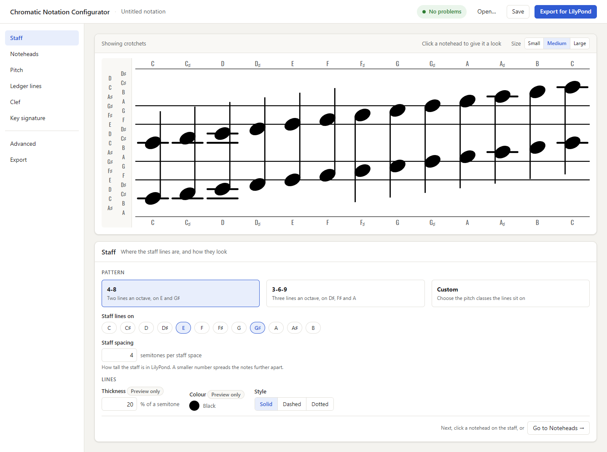
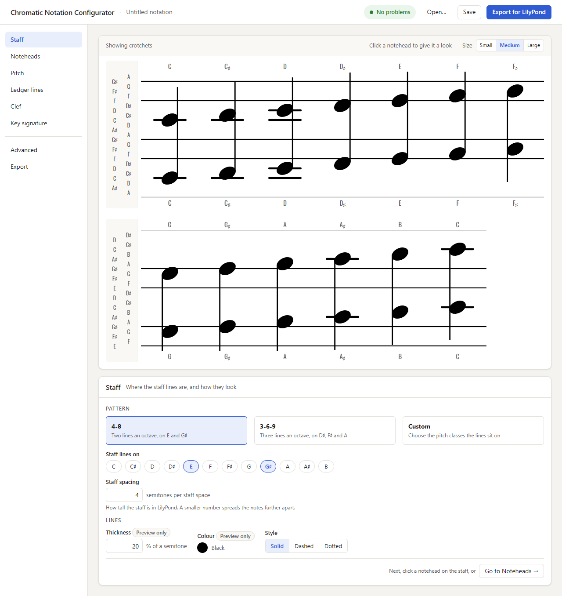
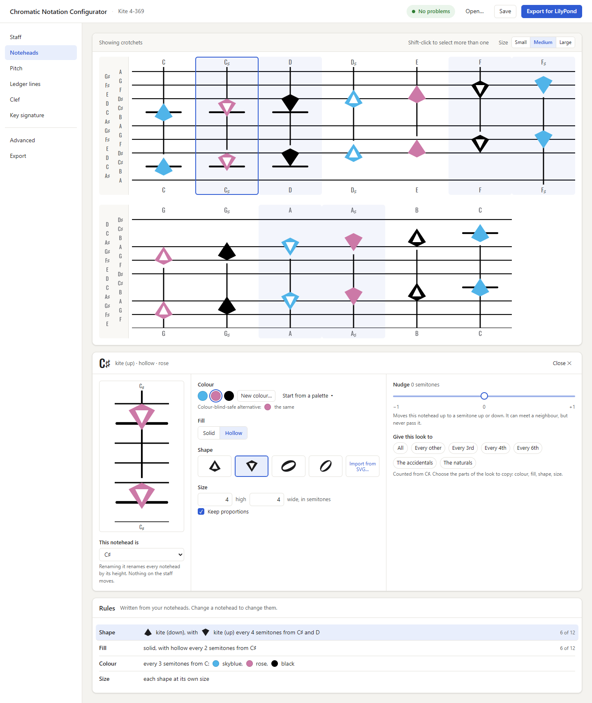
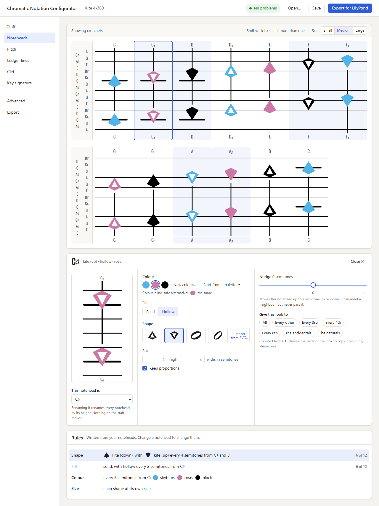
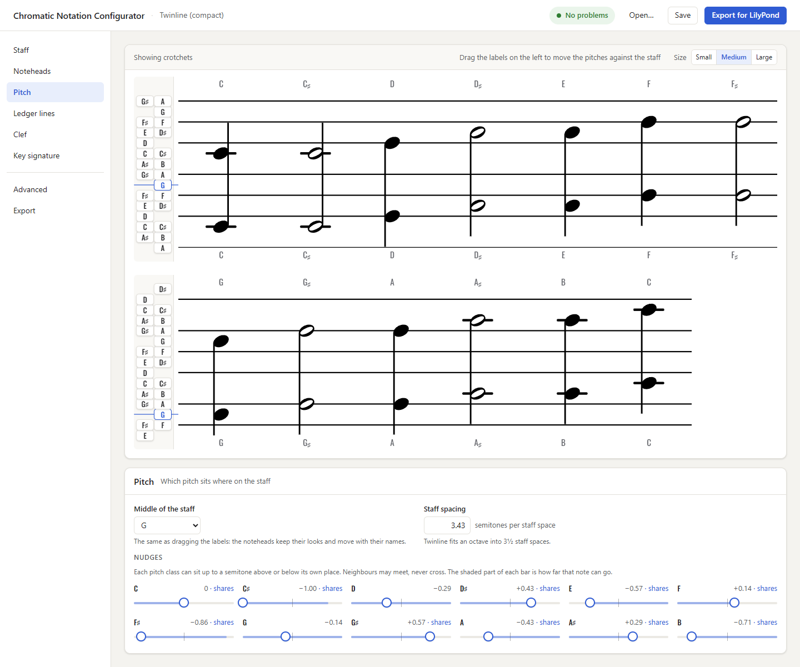
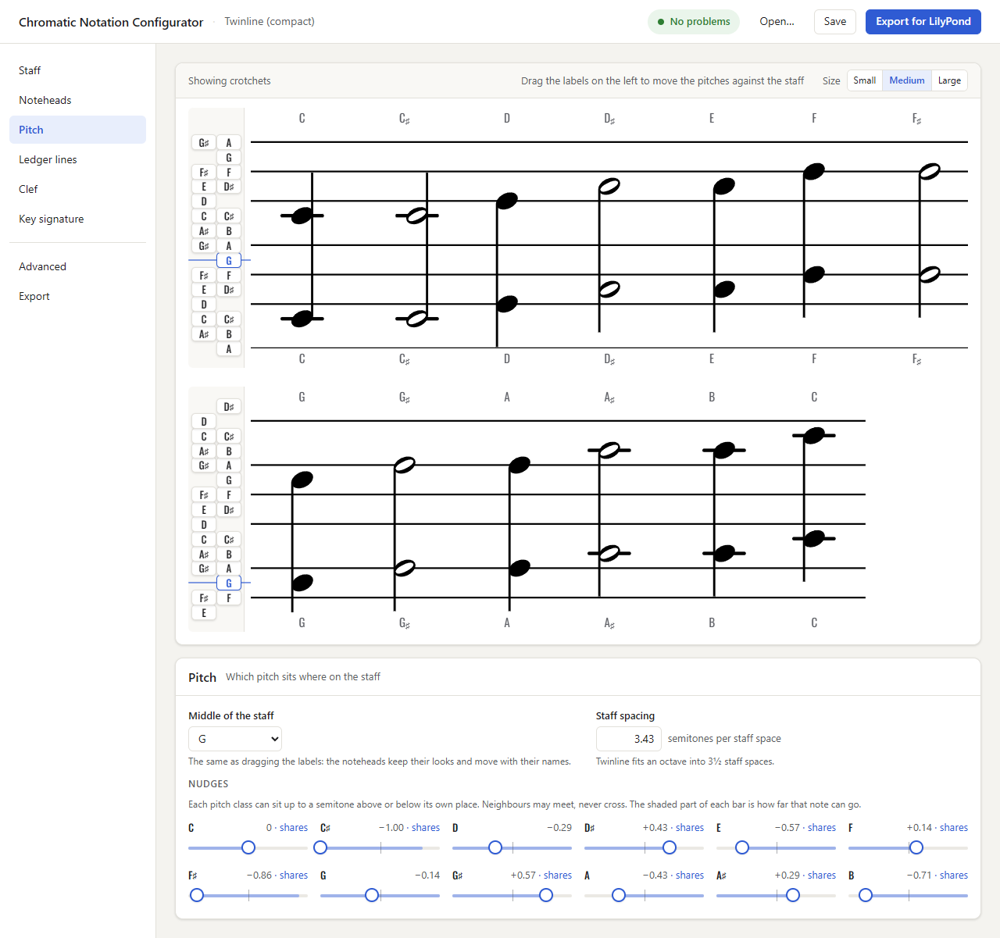
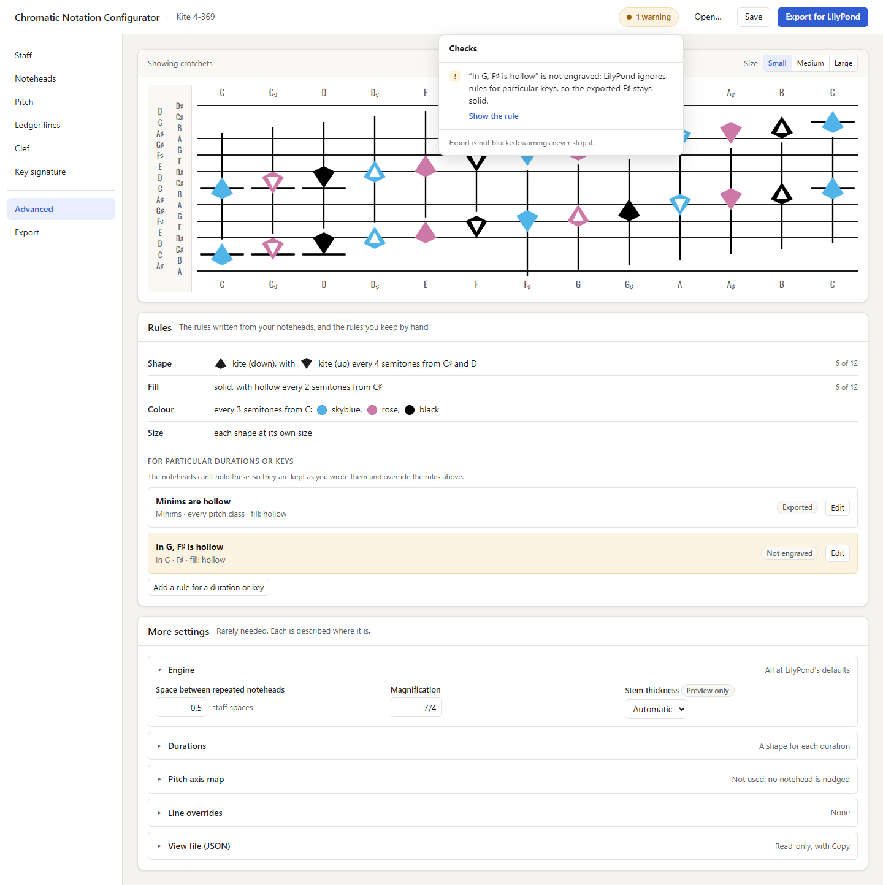
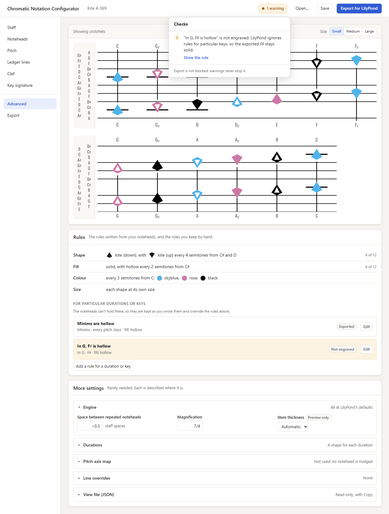

# Notehead-first editor: design

**Date:** 2026-11-06
**Status:** Design for the operator's approval (session 19; the canvas
revised in session 20, §6.1). No code changes. The implementation sessions are planned once this design is
approved.
**Why:** On 2026-11-05 the operator found the configuration screen
"extremely complicated and daunting", and on 2026-11-06 said it "looks like
somebody's experiment". The operator proposed building the editor around
the noteheads: the user defines each notehead, and the Configurator infers
the rules from them. Today the user writes the rules.
**Mock-ups:** [`notehead-first-mockups/`](notehead-first-mockups/), static
HTML drawn with the real preview modules. They are shown in §10.

---

## 0. Principles

1. **The user draws and the Configurator writes the rules.** Every choice
   the user makes is a property of a notehead. The rules, palette and pitch
   axis in the config are written from those choices.
2. **The config schema and the export stay as they are.** The editor
   writes the same `noteheadRules`, `palette`, `staff`, `ledgers` and
   `pitchAxis` sections as today, so the preview, the exporter, the JSON
   files and the gallery are unaffected. One small schema relaxation is
   argued in §3.4 (a decimal staff spacing); it needs no engine change.
3. **Loading never rewrites.** Opening a config shows it as noteheads. The
   config is rewritten only when the user changes a notehead, and then only
   in the sections that change. A file that is opened and saved without
   edits is saved unchanged.
4. **One editor state, the look table.** It is twelve rows, one per pitch
   class, each holding that pitch class's look (shape, colour, solid or
   hollow, size), its nudge and its sideways offset. Every control edits
   this table. Every config write is a pure function of the table and the
   staff.
5. **The noteheads keep their size; the window changes the spacing.** The
   canvas never scales with the window, and the octave never scrolls
   sideways at the supported widths: spare width spreads the columns, and
   a narrow window gets two rows (§6.1).

---

## 1. Flow

The page is one screen: a top bar, a section list on the left, and the
**staff canvas** in the middle with the panel for the current section
under it. The canvas is always visible (§7).

*(Session 39: the page now opens on a first section, **Notehead height**,
which sets every notehead's height in semitones on the default 4-8 staff,
carried by the Default rule. The section list follows the order a notation
is designed: Notehead height, Staff, Pitch, Ledger lines, Noteheads, Key
signature, Clef, then Advanced and Export. Every section stays reachable
at any time. The steps below keep their original numbering.)*

1. **Staff.** The staff editor stays as it is today: choose a pattern (4-8,
   3-6-9 or custom pitch classes), with line thickness, colour and style.
   Only its styling and wording change (§8).
2. **Noteheads.** As soon as a staff exists, the canvas shows 13
   placeholder noteheads, C to C′, one column per pitch class, each drawn as
   the octave pair that the preview already draws. Every placeholder starts
   with the same look: the default oval, solid, black, at its own semitone,
   with no nudge.
3. **Ledger lines.** The placeholders show ledger lines from the default
   rule, **Automatic**: a ledger line can appear wherever the staff's own
   spacing continues into a gap or beyond the outer lines, and it appears
   when a notehead is closer to it than to any staff line (today's
   proximity rule, written as proximity templates at those positions). The
   Ledger lines section offers a second choice, **My own rules**: a list of
   "at this spot, show a ledger line when one of these pitch classes is
   played" (today's override templates, in today's template editor,
   restyled). Switching to My own rules starts from the automatic positions,
   so the user edits rather than starts from nothing. Under nudges (§3.2)
   the Automatic spots follow the lines as the nudges place them: whole
   staff spacings from each line into the gap before the next, so Twinline
   in nudge form gets its spots at C and A♯. Moving the pitch, renaming a
   notehead or changing a nudge rewrites Automatic spots for the new staff,
   and never touches My own rules *(session 28)*.
4. **Pitch.** The label strip on the left of the staff (§4.2) says which
   pitch class each spot holds. By default C sits where the staff pattern
   puts it.
5. **Clef and key signature.** These sections stay as they are, restyled
   and with their own previews (§6).
6. **Export.** The top bar's **Export for LilyPond** button downloads the
   `.ly` file. The Export section holds the file name and the notation
   label and footnote, and says once, in one sentence, which settings are
   preview-only.

---

## 2. Clicking a notehead

A click on a notehead (either one of the octave pair) selects its pitch
class, outlines its column, and opens the **notehead panel** directly under
the canvas, in place of the section's panel. Esc or ✕ closes it. The
canvas keeps its full width. *(The first mock-up put the panel in a 320 px
side sheet on the right. At 1280 px that left the 13 columns at about 6 px
per semitone, too small to read, so the panel docks under the canvas.)*
The panel holds:

| Control | What it sets | Where it is written |
|---|---|---|
| **Colour** | A row of swatches of the colours already in use, then **New colour…**, which opens a colour picker. Each colour has an optional colour-blind-safe alternative, set once for that colour. A **Start from a palette** menu fills all twelve colours from a preset (today's palette list). | `palette.colors` and `palette.cbSafeColors`, one entry per pitch class (§5.3) |
| **Fill** | Solid or Hollow, a two-button toggle | inferred notehead rules, `apply.hollow` |
| **Shape** | Thumbnails of the shapes in the config, then the built-in shapes, then **Import from SVG…** (today's importer) | inferred rules, `apply.shape`. A built-in shape is copied into `config.shapes` when first chosen. |
| **Size** | Height and width in semitones (0.25 to 4), with an aspect-ratio lock that is on by default. The shape's own size is the reset value. | inferred rules, `apply.heightSemis` / `apply.widthSemis` (the fields session 22 adds) |
| **Pitch class** | "This notehead is: C ▾", which renames the notehead (§4.1) | `staff`, `ledgers`, the look table (§4.1) |
| **Nudge** | A number field from −1 to +1 semitone in a light grey frame, and the notehead dragged up or down on the canvas with Pitch open (§3; sliders until session 43) | `pitchAxis` (§3.2) |
| **Side step** | Shown only when the nudge makes this notehead share a spot with a neighbour: a horizontal offset in staff spaces, so the two stay readable | inferred rules, `apply.xOffsetStaffSpaces` |

The panel has three columns: on the left, the selected notehead drawn
alone at the Large size on its piece of staff, so a change is seen up
close while the canvas above shows it in context (§6), with the
pitch-class control under it; in the middle, the look (colour, fill, shape, size); on the
right, the nudge (and the side step, when shown). The inferred rules
(§5.4) are listed under the panel.

**Selecting several.** A Shift-click on the canvas adds a notehead to the
selection (a Ctrl-click or Cmd-click too, since session 38), and the panel
then edits all the selected noteheads together. Esc or Close clears the
selection. Since session 38 the canvas and the panel say how: the canvas
toolbar's hint and a hint under the panel's head on adding, dropping and
clearing. This is how a designer says "every third note is blue" without
writing a rule. *(Until session 42 a row of quick selections, Give this
look to, copied chosen parts of the look to All, Every other, Every 3rd,
4th or 6th, the accidentals or the naturals. Beside a selection made on
the canvas it read as a contradiction, and the operator had it removed.)* The inference (§5) then finds the same
pattern again.

**Built-in shapes.** A small set, so a new user can design without
importing anything: the default oval (today's `crotchet-minim`), and the
three shapes already in the repository's fixtures (45° ellipse, kite up,
kite down). Each is stored with its SVG and LilyPond data, as an imported
shape is. More can be added later with the toolkit. A built-in shape enters
the config only when it is first used, and the exporter already emits only
the shapes in use, so an unused built-in shape changes nothing.

---

## 3. Pitch and pitch axis

These are two independent variables, a central tendency and a variance
(operator, 2026-11-06).

### 3.1 Pitch: one number

**Pitch** is which pitch class sits at the middle of the staff. It is
`staff.midpoint`, snapped to whole semitones. It is set by dragging the
label strip or by naming a notehead (§4), and it is shown in the Pitch
section as "Middle of the staff: G♯".

The config stores the staff in pitch terms (`staff.semitonePattern` lists
the pitch classes the lines sit on). So when the pitch moves by *d*
semitones and the staff should stay where it is on the page, the editor
rewrites, by the same *d*: `staff.midpoint`, each `semitonePattern` entry
(mod 12), each ledger template's `semiWithinOctave` and `triggerPCs` (mod
12), and the keys of `staff.lineOverrides` and `ledgers.lineOverrides`. The
staff-line positions the exporter emits, `2 × (S − midpoint) / sps`, are
unchanged by this, because `S` and `midpoint` move together. Only which
pitch is drawn where changes.

### 3.2 Pitch axis: a nudge per pitch class

**Pitch axis** is a nudge per pitch class, from −1 to +1 semitone. 0 means
the notehead is centred on its own semitone. A notehead's position is its
pitch class plus its nudge. This replaces editing the axis map directly.

It is written through today's pitch-axis machinery, so the engine needs no
change:

| `pitchAxis` field | Written as |
|---|---|
| `enabled` | `true` while any nudge is non-zero. When every nudge is back at 0, the editor removes the section, which restores byte-identical linear output (design D3 of the pitch-axis design). |
| `kind` | `"pitch-class-map-v1"` |
| `octaveStride` | `12` |
| `axisUnitsPerStaffSpace` | `staff.semitonesPerStaffSpace` |
| `pitchClasses[pc].position` | `pc + nudge(pc)`, fractional allowed |

With every nudge at 0 this is the identity map, which the pitch-axis design
already proves exports exactly as the linear path.

**Every pitch class has its own nudge** *(session 43)*. A stride-12 map,
the form above, is read as it is written: `nudge(pc) = position(pc) − pc`,
C's included. From session 28 to 42 nudges were measured from C, whose
nudge always read 0, so the notehead in the middle of the default staff
could not be nudged (operator's try-out, session 42). Shifting every
position by the same amount still draws and engraves the same staff (the
preview and the export both measure from the middle of the staff's
position), so twelve equal nudges are allowed and change nothing on the
page. A map at another stride (Twinline's 7) is still rescaled and read
from C (§3.3): that is only how it is brought into nudge form.

**Nudging on the canvas** *(session 43)*. With the Pitch section open, a
notehead is dragged up or down on the canvas: its column follows the
pointer, and the release nudges its pitch class by the distance dragged,
stopped at its neighbours (`CNBPitchModel.dragNudge`). A press that does
not move still selects. The Pitch section's sliders went in the same
session: each pitch class keeps its name and its number field, framed in
light grey so it is clear which notehead it belongs to.

**No reordering.** Nudges may make neighbours share a spot but may never
reorder notes. Position must not decrease from one pitch class to the next,
including across the octave (`11 + nudge(11) ≤ 12 + nudge(0)`). This is the
map rule that validation already enforces (PA-8). The nudge of a pitch
class therefore stops at the neighbours: its range is
`[max(−1, nudge(pc−1) − 1), min(+1, nudge(pc+1) + 1)]`, wrapping at B and C.
Reaching the stop is how a user makes two noteheads share a spot. The panel
then shows the Side step control (§2).

### 3.3 Twinline in ±1

The Twinline fixture (`twinline-compact.json`) has seven positions per
octave, with stride 7 and 2 axis units per staff space. Its nudges come
from rescaling its positions to stride 12, measured from C (a map at a
stride other than 12 only):

```
nudge(pc) = (position(pc) − position(0)) × 12 / octaveStride − pc
```

| pc | C | C♯ | D | D♯ | E | F | F♯ | G | G♯ | A | A♯ | B |
|---|---|---|---|---|---|---|---|---|---|---|---|---|
| position (stride 7) | 0 | 0 | 1 | 2 | 2 | 3 | 3 | 4 | 5 | 5 | 6 | 6 |
| nudge | 0 | −1 | −0.29 | +0.43 | −0.57 | +0.14 | −0.86 | −0.14 | +0.57 | −0.43 | +0.29 | −0.71 |

Every nudge is within ±1. The largest is −1, C♯ onto C. The five shared
pairs land on the same spots (D♯ and E both at 3.43, and so on), and the
staff lines collapse as they do today.

### 3.4 Compactness becomes staff spacing

Twinline's compactness is how many staff spaces its octave takes: 7
positions at 2 per staff space, so 3.5. In the nudge form the octave is 12
units, so the same compactness is a staff spacing of 12 / 3.5 ≈ 3.43
semitones per staff space, written to `staff.semitonesPerStaffSpace` (the
staff's spacing setting) and from there to `axisUnitsPerStaffSpace`. In
general it is `axisUnitsPerStaffSpace × 12 / octaveStride`. The
engraved geometry is the same as today's fixture: for example D's staff
line is at `2 × (1.71 − 6.86) / 3.43 = −3` half-spaces, as now.

This needs one relaxation: the staff spacing may be a decimal. The schema
already accepts any number (`validate` checks only that it is a number),
and the engine divides by `cnb:semitones-per-staff-space` with Scheme's
`/` everywhere, so the engine needs no change. The Staff section's
spacing field gains decimal input, and the first implementation session
that writes a decimal value confirms it with an engine render (§11).

### 3.5 A map that needs more than ±1

A config whose map gives some pitch class a nudge outside ±1 by the formula
above (for example three pitch classes collapsed onto one spot, or a map
that is not evenly spaced) is kept as it is. The Pitch section says "This
file uses a custom pitch axis that nudges can't show", the nudge fields
are disabled, and the map stays editable in **Advanced › Pitch axis map**
(today's pitch-axis editor). The rest of the editor works normally. A
stride-7 map that does fit is also kept as it is until the user changes a
nudge or the spacing. Only then is it rewritten in the stride-12 form,
which engraves the same positions, though the `.ly` text differs.

Renaming a nudged notehead (§4.1) rotates a stride-12 map's nudges as they
are, so each spot keeps its nudge and the map stays in nudge form (session
43). From session 28 to 42, when nudges were measured from C, renaming
Twinline's C to G left a map that needed −1.14 from its new C and showed
as a custom pitch axis.

---

## 4. Assigning a pitch class

Assigning a pitch class is two assignments at once (operator, 2026-11-06):

- **A.** pitch class → staff position (does middle C sit at the centre?),
  which is the pitch of §3.1;
- **B.** this notehead's current look (shape, colour, fill, size) → that
  pitch class.

### 4.1 Naming a notehead makes both

The notehead panel's **This notehead is: C ▾** says "make this C". The spot
becomes C (A), and so does the look drawn there (B). Every other notehead
relabels by its vertical position relative to it. Nothing on the page
moves; only the names change.

The editor shifts the pitch by the *d* (from −6 to +5 semitones) that takes
the old name to the new one, as in §3.1, and rotates the look table by the
same *d*, so each look stays at its spot.

### 4.2 The label strip makes the first alone

A strip of pitch-class labels sits on the left of the staff, outside it,
one label per semitone, level with the spot it names. In most sections the
labels are plain grey text that says which pitch each spot holds. In the
Pitch section they become draggable chips, and a blue line marks the
middle of the staff. Dragging any label moves the whole strip up or down,
snapping to semitones. Each look stays
with its pitch class and moves with its label, so the noteheads ride along
and the staff stays still (A only). The noteheads' looks are not changed.

*(Session 28, as built.)* During the drag the strip's labels follow the
pointer in whole semitones while the middle-of-the-staff line stays put.
On release the pitch moves by the semitones dragged. The canvas always shows
C to C′ (§11), so after the drop the strip and the noteheads are drawn
back in their places and the staff is drawn moved the other way. Relative
to the staff, that is the same picture the drag showed. The Pitch section's
**Middle of the staff** select does the same in one step.

The labels sit one semitone apart, too close to read in one column, so they
stagger in two columns: **even pitch classes on the left** (C, D, E, F♯,
G♯, A♯) and odd on the right. That gives each column two semitones per
label, and C always reads first. Staggering also sets
apart labels that share a spot under a nudge, because sharing neighbours
are one even and one odd. In the rare case of three neighbours sharing a
spot, the two in one column show as one chip, "C·D".

### 4.3 Where a nudge goes

| Way | The nudge | Why |
|---|---|---|
| Naming a notehead | **stays with its spot** (it rotates with the look table) | Naming changes names only. The picture on the page is unchanged, and a nudge is part of the picture. |
| Dragging the label strip | **travels with its pitch class** | The strip moves pitch classes against the staff, and each carries its whole look, nudge included. |

Both keep the nudges legal: rotating the table keeps the cyclic order, and
moving the strip does not change any pitch class's relation to its
neighbours.

---

## 5. Rule inference

### 5.1 The algorithm

The input is the look table. Each attribute is inferred on its own: shape,
fill, size and side step become notehead rules, and colour becomes the
palette (§5.3).

For one attribute with value `v[pc]`:

1. **Default.** The most common value, with ties broken by C's value,
   goes in the Default rule (priority 0, all pitch classes), which carries
   the default of every attribute at once.
2. **Pattern.** Find the smallest period *p* in 1, 2, 3, 4, 6 for which
   `v[pc] = v[(pc + p) mod 12]` for every pitch class. These are the
   divisors of 12, so a pattern with one of them repeats evenly through the
   octave.
3. **Accidentals.** If there is no such period, check whether the values
   split exactly into the accidentals (C♯ D♯ F♯ G♯ A♯) and the naturals.
4. **Otherwise** the attribute has period 12: its pitch classes are listed
   explicitly.
5. **Rules.** Write one rule for each non-default value, matching exactly
   the pitch classes that have it, with `durations: "all"` and
   `keys: "all"`. The rule's name says the pattern: "Kite-up, every 4
   semitones from C♯ and D", "Hollow on the accidentals", "Hollow on C, E
   and G♯". Rules for different attributes set different `apply` fields, so
   they never conflict, and their priorities follow the attribute order
   (shape, fill, size, side step) after the Default.

Because each rule lists its pitch classes explicitly, the rules always
resolve to exactly the look table. The pattern only names the rule and
decides how few rules there are. **A rule that no pattern fits is kept as
an explicit list** of pitch classes (step 4). It is just as exact, and it
says so in its name.

### 5.2 Worked examples

| Config | Look table | Inferred rules |
|---|---|---|
| Default (4-8) | oval everywhere, accidentals hollow | Default (oval, solid) · "Hollow on the accidentals" [1 3 6 8 10] |
| Kite 4-369 | shape: down up up down repeating; fill alternates; colours sky-blue, rose, black repeating | Default (kite-down, solid) · "Kite-up, every 4 semitones from C♯ and D" [1 2 5 6 9 10] · "Hollow, every 2 semitones from C♯" [1 3 5 7 9 11] · colour "every 3 semitones: sky-blue, rose, black" (palette) |
| 45deg-369 | one shape; fill alternates; colours black, puce, sky-blue repeating | Default (ellipse-45deg, solid) · "Hollow, every 2 semitones from C♯" [1 3 5 7 9 11] · colour "every 3 semitones: black, puce, sky-blue" (palette) |
| Twinline | one shape; accidentals hollow; side step on the upper note of each shared pair | Default (oval, solid) · "Hollow on the accidentals" [1 3 6 8 10] · "Side step 0.85 on C♯, E, F♯, A and B" [1 4 6 9 11] (no pattern: explicit) |

The Kite and 45deg rows produce the same rules as the hand-written
fixtures, with new names. The export depends only on what the rules
resolve to, so it does not change.

### 5.3 Colour lives in the palette

Colour is the one attribute not written as rules. The palette is already a
per-pitch-class table (`palette.colors`, one entry per pitch class), and
`palette.cbSafeColors` holds each colour's colour-blind-safe twin, which
the exporter pairs with it. Both checked-in reference configs, Kite and
45deg, keep their colours there with no colour rules. Writing colours a
second time as rules would make two sources for one fact. So the editor
writes colour to the palette and leaves `apply.color` unset in the rules it
writes. The inference still finds colour's pattern, and the rule list
shows it as a row like the others ("Colour: every 3 semitones, sky-blue,
rose, black").

A loaded config whose rules set `apply.color` shows those colours on the
noteheads. On the first colour edit, they move into the palette, which
resolves and exports the same colours.

### 5.4 Showing the rules

The Noteheads section, under the canvas, lists the inferred rules in plain
words, one line per attribute with swatches or thumbnails: "Shape: kite
down, with kite up every 4 semitones from C♯ and D". Hovering a line
outlines the noteheads it covers on the canvas. The rules are read-only
here. To change a pattern, the user changes the noteheads.

### 5.5 Rules the inference does not own

The inference writes only rules that match every duration and every key.
Rules restricted to some durations or keys, and `offKeyMark`, cannot come
from the look table, which is per pitch class only. They are **kept
verbatim**: the editor never deletes or reorders them, and they stay above
the inferred rules in priority, so they keep overriding as they do now.
They are listed and editable in **Advanced › Rules for particular durations
or keys** (today's notehead rule editor, restyled), each with a badge
saying whether it is exported. A key-scoped rule is marked **Not
engraved**, because Section C resolves with no key (LY spec §5.2a). A notehead that such a
rule changes shows a small marker in its panel: "1 rule for particular
durations also changes this notehead — Advanced".

When the editor first rewrites the rules of a loaded config, the
pitch-class-only rules are replaced by the inferred set, which resolves to
the same looks. Nothing the config could express is lost.

---

## 6. Previews

Each section shows the staff it needs:

| Section | Preview |
|---|---|
| Staff | the full staff canvas (the 13 noteheads on the new staff) |
| Noteheads | the full canvas, with the columns of a hovered rule tinted. The notehead panel adds the selected notehead alone at the Large size. |
| Pitch | the full canvas with the label strip in drag mode and the middle of the staff marked |
| Ledger lines | the full canvas, with the columns that show ledger lines highlighted and every candidate ledger spot drawn faintly |
| Clef | a partial staff: the clef gutter and the first three columns |
| Key signature | a partial staff: the signature gutter with the selected key, and the first three columns |
| Advanced, Export | the canvas only: they add nothing to the staff to show |

The duration and key selectors (today's preview controls) sit in a small
toolbar on the canvas.

### 6.1 The canvas reflows; it never scales

*(Revised in session 20. Session 19 scaled `display.pxPerSemi` so the 13
columns always fitted. The operator asked instead that the octave never
scroll sideways and that the noteheads keep their size as the window
changes, 2026-11-06.)*

**Fixed size.** *(Revised in session 25: the Size stays in the browser,
operator, 2026-11-06. Session 20 had it as the saved
`display.pxPerSemi`.)* The canvas draws at a fixed number of pixels per
semitone, whatever the window width. The **Size** control in the canvas
toolbar sets it, in three steps: Small (9 px per semitone), Medium (11)
and Large (16). The first time, the canvas draws at Medium. After that it
draws at the step last chosen in that browser.

- **The Size is the viewer's, not the file's.** It is remembered in the
  browser's `localStorage`, under one key. That storage keeps the choice
  across reloads and after the browser is closed, and it belongs to the
  browser and the site, never to a file. It is never sent to the server,
  as a cookie would be. `sessionStorage` would forget the choice when the
  tab closes, and IndexedDB is asynchronous machinery for one word. Every
  read and write is guarded, so a browser that blocks storage simply
  draws at Medium.
- **The canvas ignores the saved `display.pxPerSemi`.** That field keeps
  its meaning for the standalone test pages and the gallery, which draw a
  file at its saved size (16 for `createDefault()` and every config in the
  repository). Choosing a step changes nothing in the file: the saved JSON
  and the exported `.ly` stay as they are, and loading never rewrites
  (§0).
- **Medium is the starting size** because it is the largest size at which
  the default config's octave fits on one row in a 1440 px window. At
  Medium the oval notehead is 30 px tall and Kite's 44 px, larger than
  printed music at reading distance, so nothing is too small to judge.
- **Large is 16**, the size the files are saved at, so Large shows a file
  as the test pages do. At Large both the default config and Kite are two
  rows at 1440 and at 1280 px. Kite's two rows need 996 px, just inside
  the 998 px the canvas has at 1280.

The canvas renders a display copy of the config with the Size as its
`display.pxPerSemi` (and the editor's label style, §6.2), and never writes
that back.

**A table of columns.** The octave is 13 equal pitch columns, C to C′.
Each column is at least as wide as the widest column the config needs (its
ledger width, `CNBCard.columnWidth`, plus 2 px either side), and any spare
width is shared equally among them, so the notes spread out on a wide
window and close up on a narrow one. Each column's drawing (noteheads,
stem, ledger lines) is centred in it. This is a CSS grid,
`repeat(13, minmax(<widest column>, 1fr))`. A fixed **14th column** on the
left holds the label strip (§4.2) and, when they are on, the clef and
key-signature gutters.

**The staff lines.** There are two ways to draw lines that run across
columns of changing width:

| | One staff SVG per row, stretched | A staff slice in each column |
|---|---|---|
| How | The row's background SVG is `width: 100%`, and each line runs from `x1="0"` to `x2="100%"`. A horizontal line stretches without its stroke getting thicker, because the SVG has no viewBox to scale. | Each column draws its own piece of every line, full column width. |
| Where columns meet | No join: each line is one element. | Columns meet at fractional pixels, so both pieces are anti-aliased at the join and show a faint lighter tick at every column edge, unless each piece overlaps its neighbour. |
| Dashed and dotted lines | One dash pattern along the whole row. | The pattern restarts in every column, so the dashes break at each edge. |
| Change to today's code | Small: the background exists already and is sized to the columns' total. It becomes `100%`. | A staff renderer inside every card. |

**Choice: one staff SVG per row, stretched.** It has no seams, keeps
dashed lines whole, and is the smaller change.

**One row or two.** When the 13 columns and the 14th do not fit, the
canvas shows two rows, **C to F♯** and **G to C′**, like two systems of
music. Each row starts with its own label strip and gutters. Both rows use
the same seven-column grid, so their columns line up, and the second row's
staff ends after C′, leaving the seventh cell empty. There is 24 px
between the rows.

Who decides, and how:

- The **page code** (`preview-display.js`) watches the canvas width
  (`ResizeObserver`) and picks one row when the width is at least the
  one-row minimum, otherwise two. It redraws only when the row count
  changes. Between those points the browser reflows the grid with no
  redraw.
- The **rendering modules stay pure.** `CNBCollection.render` takes two
  new options: `rows` (1 or 2) and `fluid` (true for the grid columns and
  the stretched staff). `CNBCollection.minRowWidth(config, options)`
  reports the narrowest width a row can take. CSS alone cannot make the
  choice, because the minimum depends on the config's shapes.

**At Medium (11 px per semitone)**, the one-row minimum is about 1,110 px
for the default config and 1,270 px for Kite 4-369. The canvas has about
1,160 px at a 1440 px window and about 1,000 px at 1280. So the default
config is one row at 1440 and two at 1280, and Kite is two rows at both,
or one row at 1440 with the Size set to Small.

**Below the two-row minimum** (seven columns and the 14th, about 640 px
for the default config and 720 px for Kite at Medium, so a window of
roughly 900 to 1,000 px), the canvas scrolls sideways inside its own card,
with a fade at the cut edge, and the toolbar suggests a smaller Size. The
page itself never scrolls sideways. The editor supports windows from
1024 px, where the reference configs (the default, Kite 4-369 and
45deg-369) fit two rows at Medium.

### 6.2 Looking better

Measured against the screenshots:

- **Equal columns.** All 13 are one width, so the octave reads as a
  regular row, not as columns sized by their ledger lines.
- **Plain pitch labels.** The column labels above and below the staff are
  plain grey text in Oswald, without the boxed chips. The editor's
  stylesheet sets this for the canvas. The chips stay the default for the
  test pages.
- **Full-height marks.** Selection is a 2 px accent outline and a faint
  tint over the whole column, labels included. Hover is the tint alone.
- **A quiet gutter.** The 14th column has the inset background
  (`--surface-2`) and a hairline on its right, so the label strip reads as
  a guide, not as notation.
- **Space between rows.** 24 px, with the second row's labels at its top.

---

## 7. Layout

```
┌─────────────────────────────────────────────────────────────────────┐
│ Chromatic Notation Configurator · Kite 4-369   ● No problems  Open… Save [Export for LilyPond] │
├──────────────┬──────────────────────────────────────────────────────┤
│ Staff        │ ┌ canvas toolbar ────────────────────────────────────┐ │
│ Noteheads  ● │ │ label │ clef │ key │  C  C♯  D  …  B  C′  (13 cols)  │ │
│ Pitch        │ │ strip │      │ sig │                                 │ │
│ Ledger lines │ └────────────────────────────────────────────────────┘ │
│ Clef         │ ┌ panel: the current section, or the notehead panel ─┐ │
│ Key signature│ │                                                    │ │
│ ──────────── │ └────────────────────────────────────────────────────┘ │
│ Advanced     │ ┌ rules (Noteheads) ─────────────────────────────────┐ │
│ Export       │ └────────────────────────────────────────────────────┘ │
└──────────────┴──────────────────────────────────────────────────────┘
```

- **Top bar**: the app name and the config's name. On the right are the
  checks indicator, **Open**, **Save** and the primary **Export for
  LilyPond** button.
- **Section list** (left, 200 px): the sections in the order a designer
  works through them. Advanced and Export sit below a divider.
- **Canvas and panel** (centre): the canvas is on top and the current
  section's panel is below it, in a column of at most 1200 px. Selecting a
  notehead puts the notehead panel in the panel's place (§2).

There is one column of content, not eleven panels of different widths.
Nothing is wider than the window at 1280 px. The canvas shows the octave
on one row or two, whichever fits, with no sideways scrolling (§6.1).

---

## 8. Look

### 8.1 Design tokens

Defined once on `:root` and used by every panel. The preview surface stays
white, because hollow noteheads are drawn with a white overlay (a known
limitation of the renderer), so the notation always sits on a white card.
The page is light-only for the same reason.

| Token | Value | Use |
|---|---|---|
| `--bg` | `#f4f3ef` | page (warm paper grey) |
| `--surface` | `#ffffff` | cards, canvas, panels |
| `--surface-2` | `#f9f8f5` | insets, toolbar, inactive controls |
| `--ink` | `#1c1c1e` | text |
| `--ink-2` | `#5b5d63` | secondary text, captions (never lighter: it passes WCAG AA on every surface) |
| `--line` | `#e2e0da` | borders, dividers |
| `--accent` | `#2f5bd3` | primary button, selection, focus ring |
| `--accent-soft` | `#e8eefc` | selected rows and pills |
| `--warn` | `#9a5b00` / `--warn-soft` `#fdf3e1` | warnings |
| `--error` | `#b3261e` / `--error-soft` `#fdecea` | errors |
| `--ok` | `#2e7d32` | the "No problems" state |
| `--space-1 … --space-7` | 4, 8, 12, 16, 24, 32, 48 px | all padding, gaps and margins |
| `--radius-s` / `-m` / `-l` | 6 / 10 / 14 px | controls / cards / popovers |
| `--shadow-1` | `0 1px 2px rgba(0,0,0,.06), 0 1px 3px rgba(0,0,0,.08)` | cards |
| `--shadow-2` | `0 8px 28px rgba(0,0,0,.14)` | popovers (the checks list) |

### 8.2 Type

- The UI font is the system stack (`system-ui, "Segoe UI", Roboto,
  sans-serif`), with no download. Pitch labels on the staff keep Oswald,
  as today.
- Sizes: 20 px page title, 16 px section title, 14 px body and controls,
  12 px captions. **Nothing is smaller than 12 px**, and nothing is lighter
  than `--ink-2`.
- Section titles are sentence case with no module or set numbers. Small
  uppercase labels are used only for group headings inside a panel, at 12
  px with letter-spacing.

### 8.3 Controls

Every control is styled: 32 px tall inputs, selects and buttons with
`--radius-s`, a 1 px `--line` border, and a 2 px `--accent` focus ring.
Toggles (Solid/Hollow, Automatic/My own rules) are segmented controls.
Pitch-class choices are pills. Colours are 24 px round swatches. Numbers
have a unit suffix ("semitones", "staff spaces"). Browser-default controls
do not appear.

### 8.4 Wording

The page speaks to a notation designer: what a setting does to the
notation, not how the code stores it.

| Today | Becomes |
|---|---|
| Intro: "…shared `config` object…change callbacks…" | "Design a chromatic staff notation: draw the staff, click each notehead to give it a look, then export it for LilyPond." |
| "Preview (Module 19)", "Save / load config — JSON (Module 17)", "Custom clef (set 009)" … | "Staff", "Noteheads", "Clef" … (section names only) |
| "Notehead rules", "apply block", "priority" | "Rules" in Advanced, described in words (§5.4) |
| "semitonePattern", "midpoint", "triggerPCs" | "Staff lines on", "Middle of the staff", "Show when these are played" |
| "Pitch axis (set 014)", "octaveStride", "axisUnitsPerStaffSpace" | "Nudge", "Staff spacing" (and the raw map only in Advanced) |

### 8.5 Validation speaks once

All validation shows in one place: the **checks indicator** in the top bar
("No problems", "1 warning" or "2 errors"). It opens a list in which each
item says the problem in designer terms and links to the control that
fixes it (selecting the notehead, or opening the section). For example,
today's "Rule "In G, F♯ is hollow" is scoped to keys (G) and is not
exported…" becomes "“In G, F♯ is hollow” is not engraved: LilyPond ignores
rules for particular keys, so the exported F♯ stays solid", with a **Show
the rule** link (mock-up 4). The panels show no validation text of their
own. An error that blocks export also shows on
the Export button as a tooltip.

### 8.6 Preview-only settings

The repeated "Preview-only" paragraphs become a small **Preview only**
badge beside each such control, with a one-line tooltip. The Export
section has one sentence listing them all.

### 8.7 Out of the way

**Advanced** holds the settings a designer rarely needs: durations and
repeat mode, engine settings, rules for particular durations or keys, the
raw pitch-axis map, ledger and staff line overrides, and **View file
(JSON)**, a read-only, collapsed viewer of the config with a Copy button.
The raw JSON is not on the main page.

### 8.8 The screenshot review, answered

| Finding | Answer |
|---|---|
| A single 7,200 px column of 11 panels of different widths | One screen: section list, canvas and one panel at a time (§7) |
| Developer language on the page | New wording table (§8.4) |
| One validation warning repeated under nearly every panel | One checks indicator, one list (§8.5) |
| Repeated "Preview-only" paragraphs | A badge and one sentence (§8.6) |
| Raw config JSON on the page | Advanced › View file (JSON), collapsed (§8.7) |
| A preview cut off at 1440 px with no sign of the missing columns | The canvas reflows to one row or two at a fixed size, and only below the two-row minimum does it scroll, with a fade at the cut edge (§6.1) |
| 11 px grey labels on unstyled browser controls | 12 px minimum, `--ink-2` minimum, every control styled (§8.2, §8.3) |

---

## 9. What it retires

| Today | Becomes | Module |
|---|---|---|
| Preview (Module 19) | the staff canvas, with its toolbar | `preview-display.js` **kept**, restyled. It gains the Size control and picks one row or two (§6.1). The range control moves to Advanced. |
| Save / load JSON (17) | **Open** / **Save** in the top bar. Its validation output moves to the checks list. | `config-io.js` **kept** (its file logic). Its panel is **retired**. |
| Export LilyPond (18) | **Export for LilyPond** in the top bar, plus the Export section | `config-export.js` **kept**. Its panel is folded into the Export section. |
| Import notehead SVG (16) | **Import from SVG…** in the shape picker | `svg-importer.js` **kept**, opened from the notehead panel |
| Colour palette (12) | the Colour row of the notehead panel and **Start from a palette** | `palette-editor.js` **retired** as a panel. Its preset list and colour-blind matching are **kept** and reused by the colour row. *(Session 27: the panel is kept for now in Advanced › Colour palette, unchanged, beside the colour row. It still sets all twelve colours at once, and the UAT drivers that pick a palette there keep working. Retiring it is left to session 32's rough edges.)* |
| Staff & ledger rules (13) | the Staff section (unchanged in function) and the Ledger lines section | `staff-rule-editor.js` **kept**. Line overrides move to Advanced. |
| Notehead rules (14) | the notehead panel plus inference. Duration- and key-scoped rules go to Advanced. | `notehead-rule-editor.js` **hidden** in Advanced › Rules for particular durations or keys (session 27), where it lists every rule, the inferred ones included |
| Common properties (15) | Advanced › Durations and Engine | `common-props-editor.js` **hidden** in Advanced |
| Custom clef (009) | the Clef section | `clef-editor.js` **kept**, restyled |
| Keys & key signature (010) | the Key signature section | `key-signature-editor.js` **kept**, restyled |
| Pitch axis (014) | nudges and the label strip. The raw map goes to Advanced. | `pitch-axis-editor.js` **hidden** in Advanced |
| Shared config state (JSON) | Advanced › View file (JSON) | (page code) **hidden** |

New modules: the look table and inference (`cnb/ui/notehead-inference.js`)
and the pitch and nudge arithmetic (`cnb/ui/pitch-model.js`), both pure
functions with unit tests; the notehead panel (`cnb/ui/notehead-panel.js`)
and the label strip (`cnb/ui/pitch-strip.js`). The rendering modules under `cnb/src/` are
unchanged apart from the hit targets the canvas needs for clicks.

**Configs the inference cannot reproduce.** Every config opens, previews
and exports exactly as today, because loading never rewrites (§0). Rules
the look table cannot hold (duration- or key-scoped rules, `offKeyMark`)
are kept verbatim (§5.5). A pitch axis beyond ±1 is kept and edited in
Advanced (§3.5). The pitch-class-only rules of a loaded config are replaced
only on the first edit, by rules that resolve to the same looks (§5.1).

---

## 10. Mock-ups

Static HTML in [`notehead-first-mockups/`](notehead-first-mockups/). The
staff, noteheads, ledgers, stems and labels are drawn by the real preview
modules (`cnb/src`, through `CNBCollection`), from the real configs: the
default 4-8 config, the Kite 4-369 fixture, and the Twinline gallery
config converted to nudges by the §3.3 formula. The rule lists come from a
small version of the §5.1 inference running on those configs, so the rules
shown are what the algorithm infers. The controls are static pictures.
`node docs/planning/notehead-first-mockups/screenshot.mjs` retakes the
screenshots, after `npm install` and with a Chromium as the UAT drivers
use, and fails on a page error or horizontal overflow. In session 19 they
were judged against this design over three rounds. The fixes were: a
quieter label strip, the "middle" marker no longer covering a label,
stronger nudge ranges, unwrapped controls, a corrected example rule, and
the notehead panel docked under the canvas (§2).

**The reflowing canvas (session 20).** The canvas is drawn as §6.1 says.
`CNBCollection` renders each row, and the mock-up then applies what the
proposed `fluid` option would do: an equal-column grid no narrower than
the widest column, each drawing centred, and the staff SVG stretched to
the row with its lines drawn to 100%. The row count comes from the
canvas width, as the page code would choose it. Every row has its own
label strip in the 14th column. The numbers match §6.1: at Medium, one
row needs 1,112 px for the default config and 1,268 px for Kite, and the
canvas has 1,158 px at 1440 and 998 px at 1280.

| Screenshot | Config, Size | Rows at 1440 | Rows at 1280 |
|---|---|---|---|
| 1. Staff | default, Medium | **one row** | **two rows** |
| 2. A notehead selected | Kite, Medium | two rows | two rows |
| 3. Pitch and nudges | Twinline, Medium | two rows | two rows |
| 4. Advanced | Kite, Small | **one row** | **two rows** |

So both the default config and Kite appear on one row and on two rows.
Twinline is two rows at both widths at Medium, because the side step
widens the shared notes' columns. The mock-ups draw each config at the
Size in the table, as if the user had chosen it in the toolbar. The Size
is the browser's choice, not the file's: the files themselves stay saved
at 16 px per semitone, which only the test pages and the gallery read
(§6.1).

Below the two-row minimum, each row keeps the grid's minimum width, so
the canvas scrolls sideways inside its card. Both rows are drawn on the
first row's seven tracks. A check at an 880 px window, with the default
config at Medium, measured two rows (session 29, correcting session 20's
account). The first row's grid and staff SVG are both 560 px, seven
80 px tracks. The second row's grid is also 560 px with seven 80 px
tracks; its six columns fill the first six, and its staff SVG is 480 px,
ending after C′ as designed. The canvas scrolls and the page itself does
not scroll sideways.

Judging the session 20 screenshots changed one thing. The notehead
panel's close-up first showed the selected notehead between its two
neighbours. At a fixed size the neighbours no longer fit its 206 px, and
their clipped edges looked like drawing errors, so the close-up now shows
the selected notehead alone at Large (§2).

### 1. Staff, with the 13 placeholder noteheads

The default 4-8 staff with every notehead at the default look, and the
Staff section's panel. The label strip on the left is in its quiet form.
At 1440 px the octave is **one row**, with the spare width spread between
the columns. At 1280 px it is **two rows**, C to F♯ and G to C′, with the
noteheads the same size as at 1440.





### 2. A notehead selected (Kite 4-369)

C♯ is selected: its column is outlined full height, and the notehead
panel is docked under the canvas, with C♯ drawn alone at Large. Kite at
Medium is two rows at both widths. The hovered Shape rule tints the six
columns it covers, across both rows.
The rule list underneath is what the inference produces for Kite: kite
down with kite up every 4 semitones, hollow every 2, colours every 3.





### 3. Pitch and nudges (Twinline in ±1)

Twinline drawn from nudges (stride 12, staff spacing 3.43): the five
shared pairs sit level on the real preview, which confirms §3.3. The label
strip is in drag mode in each of the two rows, with shared labels side by
side and the middle of the staff marked at G. Each nudge bar shades how far that note can go
before it would pass a neighbour.





### 4. Advanced, and the checks list

The Size is set to Small, which puts Kite on **one row** at 1440 px; at
1280 px it is **two rows**. The single checks list is open from the top
bar. Advanced holds the
inferred rules, the kept rules for particular durations or keys with their
export badges, and the rarely needed settings, collapsed, including View
file (JSON).





---

## 11. Risks

- **A decimal staff spacing** (§3.4) has been engraved (session 24).
  Twinline in nudge form, with a staff spacing of 3.4286, engraves every
  notehead and staff line within 0.01 half-space of the stride-7
  fixture, the tolerance the test asserts. The engine render is the last test in
  `cnb/tests/cnb-pitch-model-tests.js`, and it skips with the reason when
  `lilypond` is not on `PATH`.
- **The staff's edges under a pitch shift** (§3.1). The exporter and the
  preview expand the staff pattern over semitones 0–23. So when a shift
  carries a line past one edge of that range, the line comes back at the
  other edge. Relative to the middle of the staff, the pattern is
  unchanged, but the staff can gain a line at one end and lose one at the
  other. Session 24's tests pinned exact positions only while no line
  crossed an edge.

  **Decided in session 28** (operator, 2026-11-07): the **exported** range
  follows the middle of the staff. The exporter expands the pattern over
  the 24 semitones from `staff.midpoint − 12` to `staff.midpoint + 11` (LY
  spec 1.3.5 §5.1a), so every shift and every rename exports the same staff
  relative to its middle. Renaming C to F♯ on the default staff still
  exports `'(-4 -2 2 4)`, which a test in
  `cnb/tests/cnb-pitch-model-tests.js` pins. At midpoint 12 the range is
  0–23, so every reference config and gallery file exports as before,
  except Twinline (midpoint 7). Its exported staff becomes
  `'(-6 -3 -1 1 4 6)`, three lines either side of G instead of two below
  and four above. The **drawn** range needs no change: the canvas always
  shows C to C′ and draws every line the pattern puts within that range,
  so no line wraps. When the pitch moves, the staff is drawn moved against
  the C-to-C′ frame, and the picture relative to the staff is the same.
- **Hit targets.** Clicking a notehead needs the card to mark each column
  with its pitch class (a `data-pc` attribute). That is a small change to
  `cnb-card.js`, pinned by the preview baseline.
- **The canvas and the test pages can show a file at different sizes.**
  The Size is kept in the browser's `localStorage`, not in the file
  (§6.1), so the canvas draws at Small, Medium or Large while the
  standalone test pages and the gallery draw the file at its saved
  `display.pxPerSemi`. That is intended: the viewer picks the size, and
  the file stays unchanged. Large (16) matches every file in the
  repository, so choosing it shows a file as the test pages do. A browser
  that blocks storage draws at Medium every time.
- **The fixed layout must not move.** The `fluid` and `rows` options are
  off by default, and with them off `CNBCollection` runs today's code
  unchanged. The preview baseline (`cnb/fixtures/preview-baseline.json`)
  pins that, and new tests pin the fluid layout: the minimum row width, the
  row split, and the staff lines drawn to 100%.

---

## 12. Proposed program

For the operator to approve. Once it is approved, these sessions go into
`session-plan.md`. Nothing is released until the new UI is stable
(operator, 2026-11-06), so the only release is the last session.

### Sessions 20 to 22 come first, as planned

- **Session 20, this design revision** (the canvas reflows instead of
  scaling, §6.1), was inserted before the others on 2026-11-06, and the
  program below is numbered from 23.
- **Session 21, the colour picker stays open,** is unchanged. The operator
  meets the bug today. Two of its four editors stay as panels (staff, key
  signature), the rule editor lives on in Advanced, and the new colour row
  (session 27) uses the same wiring: `input` updates live and `change`
  redraws.
- **Session 22, each notehead has its own height and width,** is
  unchanged. It adds the `heightSemis` / `widthSemis` fields, preview and
  export that the notehead panel's Size control drives, so it must come
  before session 27. Its rule-editor controls stay useful in Advanced.

### The implementation sessions

| Session | Work | Uses | Release |
|---|---|---|---|
| **23. The look table and rule inference** | `cnb/ui/notehead-inference.js`, pure functions: the look table from a config, the §5.1 inference, and the write back to rules and palette, keeping scoped rules (§5.5). Tests in its test file: for every gallery and fixture config, writing back its own look table resolves to the same looks for every pitch class, duration and key, and the Kite, 45deg-369 and default exports stay byte-identical. | — | none |
| **24. Pitch, nudges and staff spacing** | `cnb/ui/pitch-model.js`, pure functions: moving the pitch (§3.1), nudges to and from `pitchAxis` (§3.2–3.3) with their limits, renaming (§4.1), and the ±1 test (§3.5). The staff spacing accepts a decimal. An engine render of Twinline in nudge form confirms it engraves as the stride-7 fixture does (§11). | — | none |
| **25. The new page** | The shell (top bar, section list, canvas, one panel at a time), the design tokens and type (§8.1–8.3), the checks indicator as the only place validation shows (§8.5), Open / Save / Export in the top bar, and Advanced with View file (JSON). **The reflowing canvas (§6.1):** in `cnb/src`, `cnb-collection.js` gains the `fluid` and `rows` options and `minRowWidth`, `cnb-staff.js` draws the lines to `100%` in fluid mode, and `cnb-card.js` marks each column with `data-pc` and centres its drawing in a column wider than itself. In `cnb/ui`, `preview-display.js` gains the Size control and picks the row count. With both options off, today's layout is unchanged and the preview baseline pins it byte-identical. New tests in each changed module's test file pin the fluid layout. The existing editors are mounted in their sections or in Advanced. The UAT drivers follow the moved panels, and a new driver screenshots the app at 1440 and 1280 px. | 21 | none |
| **26. The panels speak to a designer** | The kept panels restyled and reworded (§8.4, §8.6): Staff, Ledger lines with Automatic or My own rules (§1), Clef, Key signature and Export, each with its preview (§6). Preview-only badges replace the repeated paragraphs. | 25 | none |
| **27. The notehead panel** | Click and Shift-click selection, colour, fill, shape (with the built-in shapes and Import from SVG), size, side step and Give this look to (§2), written through session 23's inference. The rule list under the canvas, with hover tint (§5.4). | 22, 23, 25 | none |
| **28. Pitch** | The label strip in both modes, in each row's 14th column, renaming a notehead, and the Pitch section: middle of the staff, staff spacing, nudges (§3, §4), with the custom-map fallback (§3.5). | 24, 25 | none |
| **29. The UI is stable** | The operator rebuilds Kite 4-369 and 45deg-369 from scratch in the new UI, and the rough edges found are fixed. README text and pictures are updated, and the full UAT runs. The operator declares the UI stable, which is the condition for session 30. | 23–28 | none |
| **30. Release 1.1.0** *(release: 1.1.0)* | Takes over the withdrawn 1.0.2 `CHANGELOG.md` entry and `version.json`, renamed to 1.1.0, and adds the new editor to it. The tag deploys the site for the first time, and the session confirms the site is up and the README link works. | 29 | **1.1.0, the site's first deploy** |

**Version.** 1.1.0, a minor release. The editor is new, but the config
schema is unchanged apart from the decimal staff spacing (§3.4), and every
existing file opens, previews and exports as before (§9). The withdrawn
1.0.2 content (the online app, the `file://` notice, 45deg-369) is folded
into it.

**Screenshot checks.** Every UI session (25–29) ends by taking the app's
screenshots at 1440 and 1280 px with session 25's driver, and judging them
against the approved mock-ups in §10: the layout, type, spacing, wording,
the row count each width should give (§6.1), and no horizontal overflow. The judgement and the screenshots are recorded
in `docs/uat-status.md`. The mock-ups are the reference for how it looks,
not a pixel target. Where an implementation session finds a better
answer, it changes the mock-up in the same session, so the two stay in
step.
